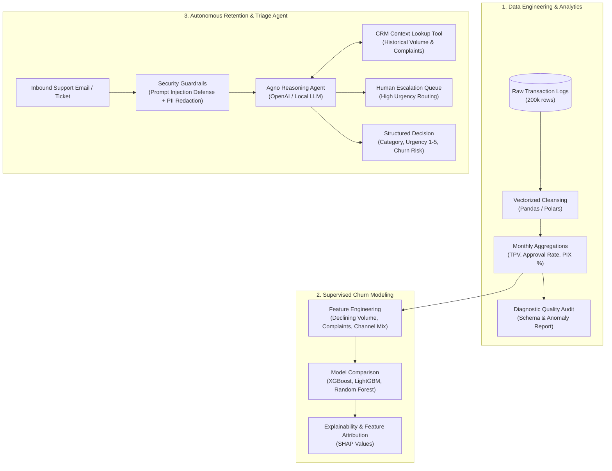

# MerchantGuard AI 💳⚡

> **End-to-End FinTech Merchant Intelligence, Churn Prediction & Autonomous Retention Agent**  
> Vectorized Data Engineering • Supervised ML • Analytical SQL • Agentic API (FastAPI + Agno)

[](https://python.org)
[](https://fastapi.tiangolo.com)
[](https://scikit-learn.org)
[](https://xgboost.readthedocs.io)
[](https://agno.com)
[](LICENSE)

---

## 📌 Project Overview

**MerchantGuard AI** is a production-grade data science and AI engineering platform built for payment processing and merchant acquiring institutions. In competitive payment markets, merchant churn directly impacts Total Processing Volume (TPV). 

This platform bridges the entire lifecycle from raw transactional data to actionable real-time retention:
1. **Data Engineering & Auditing**: Cleanses, audits, and aggregates ~200k high-frequency payment transactions across multiple channels (POS, E-Commerce, PIX, TEF).
2. **Analytical SQL**: Models historical cohort trends, rolling transaction declines, and payment method shifts.
3. **Supervised Churn Machine Learning**: Predicts 90-day merchant churn probability using gradient boosted decision trees (XGBoost / LightGBM) with full **SHAP interpretability**.
4. **Agentic Customer Support & Escalation API**: An autonomous **FastAPI + Agno Agent** microservice that parses merchant inquiries, consults CRM account context, detects churn threats, scrubs PII, and routes high-risk cases to human retention specialists.

---

## 🏗️ Architecture



---

## 🌟 Key Modules

### 1. Vectorized Data Pipeline (`src/parte1_pandas.py`)
- **Cleansing**: Vectorized normalization of non-standard timestamps, Brazilian Real currency strings, and multi-channel status flags.
- **KPI Rollup**: Zero-loop monthly aggregations calculating Total Processing Volume (TPV), transaction success rate, and digital payment (PIX) adoption.
- **Data Quality Diagnostics**: Programmatic scanner detecting negative transaction amounts, missing MCCs, and temporal leakage.
- **Heuristic Churn Screener**: Identifies pre-churn accounts exhibiting >30% volume drops combined with open unresolved complaints.

### 2. Analytical Data Warehouse SQL (`src/parte2_sql.sql`)
- Window-function queries for high-volume distributed warehouses (ANSI / Databricks SQL):
  - Top merchant performance rankings by quarterly approved TPV.
  - Rolling 30-day volume erosion leading indicators.
  - Channel migration analysis quantifying merchant shift from hardware POS to instantaneous PIX settlements.

### 3. Predictive Churn Modeling (`src/parte3_modeling.ipynb`)
- End-to-end Machine Learning notebook predicting binary churn flag `fla_churn90`:
  - Temporal train/validation splitting preventing future data leakage.
  - Imbalanced target handling via cost-sensitive learning (`scale_pos_weight`).
  - Benchmarking: Logistic Regression baseline vs. **XGBoost** and **LightGBM**.
  - Metric focus: **PR-AUC (Precision-Recall)** and **ROC-AUC** tailored for high-cost false negative risk.
  - **SHAP summary plots**: Explaining global feature importance and individual account risk factors.

### 4. Agentic API Service (`src/parte4_api/`)
- Production REST API built with **FastAPI** and the **Agno** agentic framework.
- **Two-way Guardrails**:
  - Regex & heuristic prompt injection prevention.
  - Automated PII redaction masking PAN numbers, emails, and Brazilian CPF/phones before tokenization.
- **Tool Use**:
  - `get_merchant_context`: Dynamically pulls CRM metrics (3-month TPV, complaint recency).
  - `flag_for_human_review`: Automatically enqueues high-urgency churn risks to `outputs/human_review_queue.jsonl`.
- **Deterministic Mock Mode**: Full CI/CD testability with zero external API calls (`MOCK_LLM=1`).

---

## 🚀 Quick Start

### 1. Installation
Clone the repository and install dependencies using [uv](https://docs.astral.sh/uv/) (recommended) or pip:

```bash
git clone https://github.com/adrianfuertes04/MerchantGuard-AI.git
cd MerchantGuard-AI

# With uv (fastest)
uv sync --extra dev

# Or with pip
pip install -e ".[dev]"
```

### 2. Run the Agentic API
Start the FastAPI server:

```bash
# Option A: Run in Mock Mode (Deterministic, no OpenAI key required)
MOCK_LLM=1 uvicorn src.parte4_api.main:app --reload --port 8000

# Option B: Run with live OpenAI
export OPENAI_API_KEY="your-api-key"
uvicorn src.parte4_api.main:app --reload --port 8000
```

Access the interactive API documentation at [http://localhost:8000/docs](http://localhost:8000/docs).

### 3. Run the Test Suite
```bash
MOCK_LLM=1 pytest -v
```

All integration tests (including health, prompt injection defense, schema constraints, and concurrent batches) will run with 100% deterministic local fixtures.

---

## 📡 API Reference

### `POST /classify`
Analyzes merchant correspondence and generates structured triage intelligence.

**Request:**
```json
{
  "merchant_id": 10063716,
  "email_text": "Llevo 3 días con la terminal POS sin conexión y estoy perdiendo ventas. Exijo cancelar mi cuenta inmediatamente.",
  "locale": "es"
}
```

**Response:**
```json
{
  "merchant_id": 10063716,
  "category": "churn_threat",
  "urgency": 4,
  "requires_human_escalation": true,
  "reasoning": "Merchant reports critical POS connectivity outage causing direct revenue loss, combined with an explicit cancellation ultimatum. Flagged for retention team outreach.",
  "merchant_context_used": true,
  "latency_ms": 312
}
```

---

## 📂 Repository Structure

```text
MerchantGuard-AI/
├── src/
│   ├── parte1_pandas.py       # Vectorized data cleansing & KPI aggregation
│   ├── parte2_sql.sql         # Analytical warehouse queries
│   ├── parte3_modeling.ipynb  # Supervised ML churn prediction notebook
│   └── parte4_api/            # FastAPI + Agno Agent service
│       ├── main.py            # API routing & lifecycle
│       ├── agent.py           # Agno agent, guardrails & tools
│       ├── schemas.py         # Pydantic v2 schemas
│       └── README.md          # Microservice documentation
├── data/
│   ├── transactions_sample.csv # 200k synthetic transaction dataset
│   ├── merchants_context.json  # Merchant CRM metadata
│   └── README.md               # Data documentation
├── tests/
│   ├── test_api.py            # API & security guardrail tests
│   └── test_solution.py       # Pipeline & KPI unit tests
├── outputs/                   # Generated artifacts & human escalation queue
├── Makefile                   # Productivity shortcuts
├── pyproject.toml             # Modern PEP 621 packaging
└── README.md                  # Project documentation
```

---

## 🛡️ License

This project is licensed under the MIT License.
